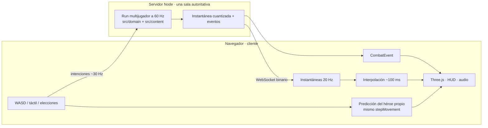
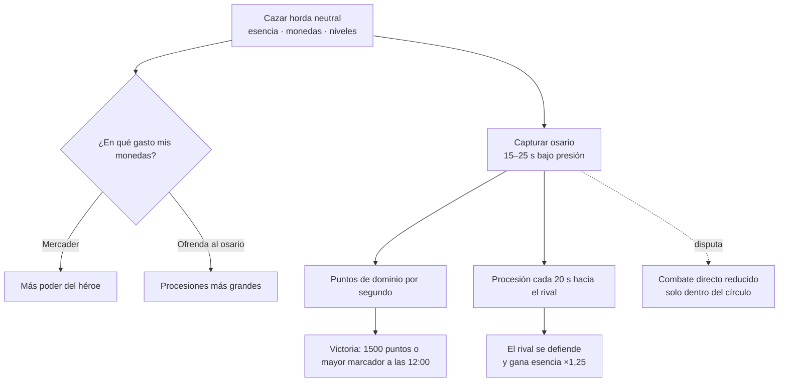

# Propuesta — Revisión del diseño para web y multijugador

Creado el 17 de noviembre de 2026 sobre la aplicación **0.2.15** (E1 completada, siguiente E2.1).

> **Idea archivada para desarrollo futuro (17-11-2026).** El usuario aprueba la dirección general y la deja archivada por ahora: no se implementa ni cambia el plan vigente (49 subfases), [ESTADO.md](../../ESTADO.md) ni el alcance del MVP, que sigue dejando el multijugador fuera ([DISENO_MVP.md §9](DISENO_MVP.md)). Decisiones ya tomadas por el usuario: en cooperativo, elegir mejoras resguarda al héroe (invencible) durante un tiempo máximo (§4.1); el VS se juega en mapas propios, habrá varios (§5.3). El resto de la §7 queda abierto para cuando se retome. El 18-11-2026 el usuario precisó que quiere un VS real completo (mundo compartido, servidor autoritativo) de bajo coste: ver [Anexo A](#anexo-a--vs-completo-viabilidad-herramientas-y-bajo-coste). Mientras tanto se sigue con el modo campaña. Todas las cifras son valores de partida para probar, no balance validado. Las mediciones citadas proceden de las verificaciones del proyecto; los anchos de banda son cálculos, no mediciones.

## 1. Resumen

**Veredicto:** el multijugador es viable y la arquitectura actual lo favorece más de lo habitual en un prototipo. La simulación es determinista, está separada del render y se ejecuta en Node sin navegador. El combate automático y los avisos largos toleran bien la latencia. El trabajo grande no es la red: es **separar el héroe del mundo** (hoy `Combat` y `Run` asumen uno solo), **quitar las pausas globales** y **abaratar la simulación de la horda**.

**Recomendación:**

1. **Servidor autoritativo en Node** con WebSocket binario, que importa el mismo `src/domain` y `src/content`. Los clientes solo envían intenciones y dibujan instantáneas y eventos. Funciona en todos los navegadores, incluido Safari móvil.
2. **Primero el cooperativo «Expedición conjunta» (2–4 jugadores)**, por invitación con enlace o código y sin cuentas.
3. **Después el VS «Dominio de los Osarios» (2c2)** en mapas propios: capturar osarios que generan muertos y dirigirlos contra el rival. Habrá combate directo solo al disputar un objetivo.
4. **Antes de la red, una preparación en un jugador (M0)** que también mejora el juego actual: elecciones sin pausa, varios puntos capturables (osarios y almenaras) y optimización de la horda.

Las decisiones que necesito están en la [sección 7](#7-decisiones-pendientes).

## 2. Revisión del diseño actual, pensando en la web

### 2.1 Lo que funciona

- **Identidad clara y profundidad de configuración:** tres clases × cuatro elementos, ocho habilidades por clase, cuatro espacios, niveles 1–10 con ramas e hitos, doce reliquias, doble afinidad y maestría ligada al élite. Da muchas razones para repetir.
- **El survivor gana una capa de exploración:** cofres, fuentes, captura y mercader en un territorio de 280 × 260 m. Esto lo separa de los survivors de arena cerrada.
- **Amenazas legibles:** línea del ballestero, franja del devastador, aviso de aparición de 1,5 s y ataques anunciados del Castellano.
- **Base técnica poco común:** dominio sin `Math.random`, sin DOM y sin three.js; semilla reproducible; paso fijo de 60 Hz con interpolación; el render consume `CombatEvent` y no decide daño; más de 280 pruebas, 14 campañas simuladas con piloto automático y CI. Casi todo esto sirve directamente para el multijugador.
- **Entrada rápida:** dos clics desde la portada hasta el combate. En web, cada pantalla extra pierde jugadores.

### 2.2 Hallazgos y propuestas

| # | Qué observé | Por qué importa | Propuesta |
|---|---|---|---|
| 1 | Subir de nivel, abrir cofres, recibir el núcleo y comprar **pausan el mundo**. Con unas 15 elecciones por partida ([RITMO_2_7_6.md](RITMO_2_7_6.md)), más cofres, captura y mercader, hay del orden de una pausa cada 20–30 s. | Corta el flujo ya en un jugador y es **incompatible con el multijugador**: nadie puede pausar a los demás. | **Bandeja de elecciones sin pausa** (M0.1): las tarjetas se acumulan en un borde y se eligen con 1/2/3 o tocándolas, sin soltar WASD ni el ratón capturado. Conservar «pausar al subir de nivel» como ajuste solo para un jugador. Los respiros de fin de minuto pasan a ser el momento natural para elegir. En cooperativo, abrir el menú **resguarda** al héroe (invencible, por tiempo limitado; ver §4.1). |
| 2 | Hay **una sola captura** («resiste 25 s por 25 monedas») y un mercader en todo el mapa. | La exploración ofrece pocas decisiones reales. El plan ya marca la captura como provisional (3.6). | **Puntos de dominio** (M0.4): generalizar `Capture` a varios puntos, capturadores y tipos. Los osarios generan muertos y las almenaras dan mejoras de expedición. Es la misma base que necesitan el cooperativo y el VS. |
| 3 | La horda aparece **alrededor del héroe y fuera de vista**, sin origen reconocible. E1.4 detectó que avanzar sin parar deja la horda atrás. | Funciona, pero el jugador no puede leer ni influir en de dónde salen los muertos. | Parte de los refuerzos sale de **osarios visibles** cuando el héroe está cerca. **Sellar** un osario en un jugador o en cooperativo reduce la presión de su sector y da un premio. Así el origen de la horda se puede leer y se convierte en un objetivo, coherente con «despejar el camino» de la Era I. |
| 4 | Falta el **ciclo entre partidas** (3.8 refugio y persistencia, 3.9 desbloqueo). | En web, la retención depende de tener un motivo para volver mañana. | Mantener 3.8–3.9 y añadir una **Expedición del día**: semilla fija diaria, la misma para todos, con marcador. La semilla reproducible la hace casi gratis. |
| 5 | La compilación pesa unos **15 MB**: texturas de 0,6–1,4 MB cada una, un HDR de 1,2 MB y JS principal de unos 840 kB. | Primera carga lenta en móvil; cada segundo de espera pierde jugadores que llegan por un enlace. | Texturas comprimidas para GPU (KTX2/Basis), carga progresiva (portada y combate primero, el resto después) y objetivo inicial de menos de 8 MB. Medir en 4.6/4.9. |
| 6 | La simulación cuesta **7,26 ms de mediana y 10,03 ms de p95 por paso de 60 Hz con 100 despojos** agrupados ([VERIFICACION_2_7_5.md](../verificaciones/VERIFICACION_2_7_5.md)). Son unos 70 µs por enemigo y paso, en escala lineal. | Hoy ocupa casi la mitad de un núcleo del navegador y limita al móvil. En un servidor, cada sala costaría casi un núcleo con 200 enemigos. | **Perfilar y optimizar** (M0.3). Candidatos a confirmar: `clearPath` recorre todos los sólidos sin índice espacial, navegación por enemigo y asignaciones dentro de bucles. Objetivo: ≤ 3 ms por paso con 200 enemigos en Node. |
| 7 | **Perder el foco pausa** la expedición. | Online, el mundo sigue. Además, los navegadores frenan las pestañas en segundo plano. | En línea no se pausa. Al volver a la pestaña, el cliente salta a la instantánea más reciente. El héroe sigue luchando solo mientras su dueño no está, porque el combate es automático. |
| 8 | Nombre definitivo pendiente y un mercado de survivors muy lleno. | Hace falta un gancho propio. | El **cooperativo 3D con resonancias elementales entre jugadores** y el **VS indirecto por osarios** pueden ser ese diferencial. |

### 2.3 Lo que la web aporta al multijugador

- **Invitar con un enlace:** `…/la-fortaleza/?sala=K7Q2` lleva directo a la sala, sin instalar nada. Es la mayor ventaja frente a un juego de escritorio.
- **Juego cruzado PC/móvil justo:** como nadie apunta, el ratón no tiene ventaja sobre el dedo. Esto vale sobre todo para el VS.
- **Sesiones cortas:** de 6 a 12 minutos por partida encajan con el uso típico de la web.
- **Clientes más ligeros:** con servidor autoritativo, el navegador ya no simula la horda; solo la interpola y la dibuja. El móvil sale ganando.

## 3. Viabilidad técnica

### 3.1 Lo que ya ayuda

| Aspecto | Estado actual | Consecuencia |
|---|---|---|
| Dominio independiente | `src/domain` y `src/content` no importan three.js ni DOM; las pruebas corren en Node | El servidor puede ejecutar el mismo `Run` sin reescribir reglas |
| Determinismo | RNG propio con semilla en `Run`, `Progression`, `ExpeditionShop` y `Exploration`; paso fijo de 60 Hz | Pruebas reproducibles, bots, «Expedición del día» y futuras repeticiones |
| Render dirigido por eventos | `combatView.events(combatEvents)`; el render no decide daño | El servidor emite los mismos `CombatEvent` y el cliente los dibuja igual |
| Entrada mínima | Movimiento, rumbo de cámara, interacción y elecciones | Mensajes diminutos; la velocidad no se puede trucar si la valida el servidor |
| Combate automático | No hay clics de ataque que predecir | La latencia solo afecta al movimiento, que se predice en el cliente |
| Avisos largos | Aparición 1,5 s, ballestero 0,9 s, devastador 1,05 s, llegada del jefe 6 s | Toleran entre 100 y 150 ms de retraso sin sentirse injustos |
| Piloto automático | `tests/simulation/campaign.ts` recorre el mapa real, elige mejoras y visita cofres, captura y mercader | Sirve como base de **bots** para rellenar salas y hacer pruebas de carga |
| Validación de elecciones | `progression.choose` rechaza opciones no ofrecidas | Reglas ya preparadas para un servidor que no se fía del cliente |

### 3.2 Lo que obliga a cambiar

| Supuesto de un jugador | Dónde está | Cambio |
|---|---|---|
| La vida, el kit, la carga elemental, las reliquias y el daño del héroe viven en `Combat` | [combat.ts](../../game/src/domain/combat.ts) (`hp`, `heroKit`, `loadout`, `relics`) | Separar `HeroState` (por jugador) de `World` (enemigos, proyectiles, índice espacial, reloj) |
| `Run.step(dt, hero)` recibe un único cuerpo | [run.ts](../../game/src/domain/run.ts) | `step(dt, inputs)` con N héroes; el director se ancla a **grupos de jugadores** |
| `event.target === 0` significa «el héroe» | [main.ts](../../game/src/main.ts) y el render | Añadir `heroId` como origen y destino en `CombatEvent`. El VS además necesita equipo y autor de cada baja |
| Los enemigos persiguen al único héroe | `Combat.step` y navegación | Elegir objetivo: el más cercano con persistencia, o por amenaza en élite y jefe. Navegación compartida con campo de flujo de varios orígenes |
| `progression.pending` y `shop.isOpen` detienen `Run.step` | `run.ts:202` | Elecciones y tienda por jugador, sin detener el mundo |
| Una cartera (`exploration.coins`), una progresión y una captura | `exploration.ts`, `progression.ts`, `capture.ts` | Carteras y progresiones por jugador; capturas con varios ocupantes y equipos |
| `isVisible` usa el frustum de la única cámara | `main.ts` | Cada cliente envía el rumbo de su cámara y el servidor aproxima un cono por jugador. «Fuera de vista» pasa a significar fuera de la vista de todos |
| La colisión sale de `createWorld` en `rendering/world.ts` (three.js) | Pruebas y `main.ts` | Exportar la geometría de colisión como datos puros. Funciona hoy en Node, pero el servidor no debería depender del render |

El riesgo de este cambio se puede controlar: con **N = 1** las 14 campañas simuladas deben dar las mismas trazas que hoy, igual que se hizo en 2.1 con «tres trazas previas idénticas».

### 3.3 Arquitectura recomendada



- **Servidor:** el mismo TypeScript. **Colyseus** encaja si se quieren salas, códigos, unión por enlace y reconexión ya resueltos; un servidor propio con `ws` sirve si se prefiere control total. En ambos casos conviene enviar la horda como **instantánea binaria cuantizada** y no como objetos JSON.
- **Cliente:** predice solo su propio movimiento con `stepMovement`, que ya es una función pura, y lo reconcilia con la posición del servidor. El resto se interpola y los ataques y efectos llegan como eventos. Los héroes se atraviesan entre sí: así no hay bloqueos ni errores de predicción por choques.
- **Ritmo:** simulación a 60 Hz en el servidor, para conservar balance y pruebas, e instantáneas a 20 Hz. Bajar la simulación a 30 Hz solo si la CPU lo exige, revalidando las campañas.
- **Despliegue:** el cliente sigue siendo estático (GitHub Pages ya está preparado) y el servidor va aparte, en una región cercana a los jugadores. El coste crece con las **salas simultáneas**, no con los jugadores registrados.

### 3.4 Presupuestos estimados

| Recurso | Cálculo | Resultado |
|---|---|---|
| Bajada por cliente | 200 enemigos × ~9 B (id, x/z en 16 bits, rumbo, vida %, estado) × 20 Hz | ~36 KB/s (~290 kbit/s) en el peor caso; mucho menos enviando solo lo cercano (~50 m) y lo que cambia |
| Subida por cliente | Intención de ~8 B × 30 Hz más elecciones | < 1 KB/s |
| Latencia jugable | Avisos de 0,9–1,5 s; despojos a 2 m/s, más lentos que el héroe a 5 m/s | Cómoda hasta ~150 ms de ida y vuelta; probar también 200 ms |
| CPU de servidor por sala | Hoy, 7,26 ms por paso con 100 enemigos (lineal) → ~14,5 ms con 200, casi el límite de 16,7 ms por paso | **Optimizar antes de alojar salas (M0.3).** Objetivo: ≤ 3 ms por paso con 200, unos 18 % de un núcleo por sala |

### 3.5 Alternativas evaluadas

| Opción | Veredicto | Motivo |
|---|---|---|
| Lockstep determinista (solo se envían entradas) | No | `Math.sin`, `Math.cos`, `Math.hypot` y `Math.atan2` no garantizan resultados idénticos bit a bit entre motores de navegadores distintos. Además, una desincronización rompe toda la partida, añade retraso de entrada y no permite unirse a mitad. |
| Rollback (estilo juegos de lucha) | No | Volver a simular 5–8 pasos por fotograma con 100–200 enemigos cuesta 35–80 ms. |
| P2P con anfitrión en el navegador (WebRTC) | Más adelante, para partidas privadas | No requiere servidor de simulación, pero el anfitrión tiene ventaja y la partida termina si se va. Hacen falta servidores STUN/TURN, un móvil anfitrión no da abasto y no sirve para un VS justo. |
| Servidores de borde o sin servidor | Solo para sala de espera, emparejamiento y marcadores | Un bucle continuo de 60 Hz con CPU alta no encaja en sus límites. |
| WebTransport o datagramas WebRTC | Mejora posible | Evitan el bloqueo de TCP ante pérdidas. Antes de depender de ellos, verificar el soporte en Safari/iOS. WebSocket queda como base universal. |

## 4. Cooperativo — «Expedición conjunta» (2–4)

**Idea:** la misma expedición (6:00, el Portador hacia 2:30 y el Castellano) jugada en grupo. Separarse permite cubrir más objetivos; mantenerse juntos da seguridad y combinaciones.

### 4.1 Reglas propuestas

- **Sin pausa global: elegir te resguarda.** Idea del usuario (17-11-2026). Al abrir una elección (nivel, cofre, núcleo o mercader), el héroe queda **resguardado** mientras el mundo sigue:
  - Es **invencible**, no se mueve ni ataca, y un sello visible indica a los demás que está eligiendo.
  - Hay un **tiempo máximo** por apertura (8 s de partida). Al agotarse, el menú se cierra y las elecciones pendientes quedan en la bandeja para más tarde. No se pierden ni se eligen solas.
  - Para evitar usarlo como escudo: solo se abre con algo pendiente, como mucho 12 s de resguardo acumulado cada 30 s, y sin contar para capturas ni reanimaciones mientras dura. Tampoco se puede abrir estando caído.
  - Los enemigos ignoran al héroe resguardado y buscan otro objetivo.
  - La bandeja con 1/2/3 sin detenerse (M0.1) sigue disponible para quien prefiera elegir en movimiento. La tienda tampoco detiene el mundo y Esc no pausa.
- **Recursos** (sin competir por el botín ni saquear a los compañeros):

| Recurso | Regla | Motivo |
|---|---|---|
| Esencia | **Compartida**: lo que recoge uno cuenta para todos; todos suben de nivel juntos y cada uno elige sus mejoras | Nadie se queda atrás ni se pelea por cristales |
| Monedas | **Ingreso compartido, gasto individual**: cada moneda recogida se abona a todas las carteras | Cada jugador compra para su configuración |
| Cofres, fuentes y mercader | **Botín personal**: cada jugador abre cada cofre una vez y el mercader tiene existencias propias para cada uno | Sin disputas ni sabotajes |
| Núcleo del élite | Uno para cada jugador vivo | Todos pueden alcanzar su maestría |
| Vida y suministros | Individuales | La supervivencia de cada uno es su responsabilidad |

- **Caído y reanimación:** a 0 de vida, el héroe cae con 30 s de margen. Un aliado a menos de 2,5 m durante 3,5 s lo levanta con 35 % de vida y 2 s de protección. Es una «mini captura» dentro de la horda que reutiliza la lógica de permanencia. Si el margen se agota, pasa a **espíritu** y reaparece a los 20 s en la llegada o en la almenara encendida más cercana, con 50 % de vida. Durante el jefe solo se puede reanimar. **Derrota:** todos caídos o convertidos en espíritu a la vez.
- **Horda por grupo:** el director agrupa a los jugadores que están a menos de 26 m (el `localRadius` actual) y mantiene un objetivo local por grupo. Separarse produce más enemigos en total (más esencia compartida, más riesgo), siempre dentro del máximo global. Las apariciones quedan fuera de la vista de **todos** los jugadores.
- **Jefe y élite:** el objetivo se elige por amenaza (daño reciente y cercanía), con un máximo de 8 s sobre el mismo jugador mientras haya más de uno vivo. Así el Guerrero puede «sostener» al jefe sin que nadie quede perseguido siempre.
- **Claridad:** efectos de los aliados más tenues que los propios, números de daño solo propios, avisos enemigos siempre por encima. Contorno de los aliados a través de muros, más su vida y nombre en el HUD.
- **Marcas (pings):** una tecla (por ejemplo, Q) o un botón táctil para «ayuda», «vamos aquí», «osario» y «mercader». En web casi nadie usa voz.

### 4.2 Escalado de partida (cifras para ajustar con bots)

| Jugadores | Objetivo local por grupo | Máximo global | Vida del élite | Vida del jefe | Esencia por nivel |
|---:|---|---:|---:|---:|---:|
| 1 | 20/40/60/90 (actual) | 100 | 320 | 1100 | ×1 |
| 2 | ×1,5 | 140 | ×1,8 | ×1,9 | ×1,5 |
| 3 | ×1,9 | 170 | ×2,5 | ×2,7 | ×1,9 |
| 4 | ×2,2 | 200 | ×3,1 | ×3,5 | ×2,2 |

La esencia por nivel escala con la horda para conservar el ritmo de elecciones de 2.7.6. Las capturas se aceleran con más ocupantes: 25 s / (1 + 0,5 × (k − 1)), es decir, 25, 16,7, 12,5 y 10 s.

### 4.3 Puntos de dominio en cooperativo

- **Osarios (2–3 por mapa):** emiten parte de la horda de su sector. **Sellarlos** reduce la presión de ese sector y da un premio único (monedas y reliquia, como hoy la captura).
- **Almenaras (2–3 por mapa):** una vez encendidas dan una mejora de expedición, por ejemplo +15 % de esencia, revelar el élite en el radar o servir de punto de reaparición con fuente. Encaja con «Las almenaras apagadas» de la [campaña por eras](IDEA_CAMPANA_ERAS.md).
- **Decisión de grupo:** «¿nos separamos para tomar dos puntos o vamos juntos?». Es la decisión que hoy falta en la exploración.

### 4.4 Resonancias elementales entre jugadores (opcional)

Cuando un enemigo tiene un estado aplicado por un jugador y recibe otro elemento de **otro** jugador, se produce un efecto pequeño. Límite: una resonancia por enemigo cada 3 s, sin cadenas. No son las fusiones completas que el MVP excluye.

| Pareja | Resonancia | Efecto propuesto |
|---|---|---|
| Fuego + Agua | Vapor | Nube de 3 m que ralentiza un 25 % durante 2 s |
| Fuego + Aire | Avivar | La quemadura salta a dos enemigos cercanos |
| Fuego + Tierra | Escoria | El siguiente golpe a un enemigo con Quebranto estalla en área pequeña |
| Agua + Tierra | Lodo | Charco de 3 m que ralentiza un 30 % durante 3 s |
| Agua + Aire | Marejada | El empuje se transmite a los enemigos contiguos |
| Tierra + Aire | Polvareda | Retrasa 0,5 s el siguiente ataque de los afectados |

### 4.5 Clases y roles

Los roles ya existen: el Guerrero agrupa y aguanta (Ímpetu, Torbellino con Aire que atrae), el Mago castiga en área (Cataclismo) y el Arquero atraviesa filas (Precisión). El **Sacerdote** de 3.9 sería el apoyo natural del cooperativo, y conviene diseñar su kit pensando en él. El Acorazado sigue aplazado por decisión del usuario; esta propuesta no lo reincorpora.

### 4.6 Flujo en la web

1. Portada → **Jugar en compañía** → **Crear sala** (código de cuatro caracteres y enlace para compartir) o **Unirse**.
2. Sala de espera: nombre sin cuenta (guardado en el dispositivo), clase, «listo» y dificultad que elige quien crea la sala. Si faltan jugadores, se pueden añadir bots.
3. Expedición, con reconexión durante 60 s si se cae la conexión. Mientras tanto, el héroe sigue combatiendo solo.
4. Resultados del equipo: bajas, daño, reanimaciones y puntos tomados, con menciones del tipo «más reanimaciones». Botón **Otra expedición** con el mismo grupo.

## 5. VS — «Dominio de los Osarios»

**Idea:** cada equipo se hace fuerte cazando hordas como en el juego normal. Los osarios del mapa generan muertos. **Capturar uno lo pone a tu servicio**: deja de generar enemigos contra ti, te da puntos y envía procesiones de muertos contra el equipo rival. El enfrentamiento es sobre todo indirecto. Solo hay combate directo cuando dos equipos disputan el mismo osario.

> Amplía la definición de captura de 1.9 («no implica colección de criaturas ni reclutamiento»). Las procesiones no son aliados controlables: son muertos hostiles redirigidos hacia el rival. Requiere confirmación del usuario.

### 5.1 Bucle de juego



### 5.2 Reglas propuestas (cifras de partida)

- **Osarios:** cinco en el mapa, cuatro menores y uno mayor en el centro.
  - **Neutral:** genera muertos neutrales que atacan a cualquiera cercano.
  - **Captura:** 3 s de aviso y luego 15 s (menor) o 25 s (mayor) dentro del círculo de 6 m, mientras el osario lanza defensores (lógica de presión actual). Más aliados dentro aceleran la captura; si hay héroes rivales dentro, el progreso se congela.
  - **Propio:** da 1 punto/s (menor) o 2 puntos/s (mayor) y una **procesión cada 20 s**.
- **Procesiones:** se dirigen al héroe rival más cercano a menos de 120 m; si no hay ninguno, hacia el campamento rival, donde se detienen ante su protección. Llevan el color del equipo que las envía. Composición por rango: I = 6 despojos; II = 9 despojos y un soldado; III = 12 despojos, un ballestero y un devastador. Como máximo 40 muertos enviados vivos por equipo receptor, para proteger la CPU y evitar avalanchas.
- **Economía con tensión:** las monedas se gastan en el **mercader** (poder del héroe) o en **ofrendas** a un osario propio (rango II por 20 y rango III por 35). Si el rival recupera el osario, la ofrenda se pierde.
- **Contra la bola de nieve:** matar muertos enviados da ×1,25 de esencia, así que presionar a un rival fuerte también lo alimenta. Recuperar un osario del equipo que va ganando es un 30 % más rápido. El tiempo de reaparición tiene un máximo.
- **Combate directo, con tres ajustes de sala:**
  - **En disputas (recomendado):** dentro de un círculo disputado, el básico y las habilidades alcanzan a héroes rivales con ×0,4 de daño y la mitad de duración de control. Fuera de los círculos los héroes rivales se ignoran y se atraviesan.
  - **Ninguno:** solo indirecto. Las procesiones son la única forma de abatir rivales.
  - **Total:** para quienes lo busquen; no es el foco.
- **Muerte y reaparición:** en el campamento propio tras 6 s + 1 s por minuto (máximo 14 s), perdiendo el 20 % de las monedas. El equipo que causó la baja suma 25 puntos, también si la causó su procesión («Tu procesión abatió a …»).
- **La hora del Castellano (8:00):** aparece en la explanada de la puerta como amenaza neutral. Reparte 400 puntos en proporción al daño de cada equipo, y el equipo que más daño hizo recibe el **Estandarte**: todos sus osarios suben a rango III durante 60 s. Así hay un clímax y una opción de remontada que no depende de quién da el último golpe, algo que con combate automático sería azar.
- **Victoria:** 1500 puntos, o el mayor marcador a las 12:00.

### 5.3 Mapas propios para el VS

Decisión del usuario (17-11-2026): **el VS se juega en mapas propios**, no en Los dominios exteriores. Habrá varios; el primero sirve de referencia para los demás.

Requisitos para cualquier mapa VS:

- **Simetría o equivalencia comprobada:** distancias y tiempos de recorrido de cada campamento a cada osario iguales con un margen de ±5 %, medidos con navegación real, como en E0.
- **Más compacto que el exterior:** del orden de 180–220 m por lado para 2c2, de modo que cruzar el mapa lleve unos 35–45 s a 5 m/s. El 3c3 puede usar una versión mayor.
- **Estructura:** dos campamentos con mercader propio y protección que la horda no cruza, cinco osarios (uno mayor central y dos pares menores), una arena central amplia para el Castellano y zonas de caza neutral con cofres.
- **Rutas:** un camino central rápido y flancos más largos y protegidos, con claros de combate de 24–40 m como en el exterior. Ningún osario debe quedar al alcance de un solo campamento sin pasar por un claro disputable.
- **Reutilización:** piezas, materiales y reglas de colisión del escenario y de su laboratorio, con geometría de colisión como datos (M0.5).

Esquema orientativo del primer mapa (sin coordenadas: se fijan al diseñarlo):

```
              Osario N-O        ARENA DEL CASTELLANO        Osario N-E
CAMPAMENTO A                       OSARIO MAYOR                       CAMPAMENTO B
              Osario S-O         caza neutral · cofres       Osario S-E
```

Tema sugerido para el primero: el **campo de asedio** a las afueras de la fortaleza (trincheras, empalizadas y fosas comunes), coherente con la Era I. Otros mapas pueden venir de la campaña: el patio interior o las catacumbas.

### 5.4 Variantes

| Variante | Jugadores | Notas |
|---|---|---|
| Dominio 2c2 | 4 | **Recomendada para empezar.** Permite dividir roles: uno defiende y otro captura |
| Duelo 1c1 | 2 | Tres osarios y partida de 10 min |
| Dominio 3c3 | 6 | Necesita un mapa VS mayor y la CPU optimizada |
| Todos contra todos | 3–4 | Las procesiones van al líder de puntos: freno natural al que va primero |
| **Asedio paralelo** | 2–8 | Cada jugador juega en **su propia copia** del mapa y capturar osarios envía procesiones al mundo de los rivales. Gana quien sobrevive o domina más. El servidor solo retransmite envíos y marcador; cada navegador simula su mundo, como hoy. **Atajo barato** para validar la idea sin el refactor M0.2, pero menos social y con el cliente como autoridad (vulnerable a trampas): solo para partidas privadas o como experimento |

### 5.5 Riesgos del VS

- **El PvP automático se reduce a comparar estadísticas.** Por eso se limita a las disputas y con daño reducido. La habilidad está en la estrategia: qué osario tomar, cuándo invertir y cuándo defender.
- **Encerrarse en el campamento:** los puntos solo llegan de los osarios, así que quedarse quieto pierde la partida.
- **Bola de nieve:** se mitiga con la esencia extra, la recuperación acelerada y el Estandarte repartido por daño. Ajustarlo con bots enfrentados 2c2.
- **Abandono y sabotaje:** expulsión por inactividad, votación para expulsar en partidas públicas y sin fuego amigo.

## 6. Hoja de ruta propuesta

Mismo formato que el plan: trabajo y criterio de cierre comprobable.

### M0 — Preparación en un jugador (sin red)

- **M0.1 · Elecciones sin pausa.** Bandeja con 1/2/3 y toque; ajuste «pausar al subir de nivel» solo para un jugador. *Cierre:* ninguna elección se pierde ni se aplica dos veces; las campañas simuladas siguen terminando; uso cómodo con WASD y en móvil.
- **M0.2 · Héroe separado del mundo.** `HeroState` y `World`; `Run.step(dt, inputs)` con N = 1; `heroId` en los eventos. *Cierre:* misma semilla, mismas trazas en las 14 campañas; suite rápida y build en verde.
- **M0.3 · Simulación de horda más barata.** Perfilar; índice espacial para sólidos; campo de flujo compartido; trabajo reducido para enemigos lejanos. *Cierre:* medición reproducible de ≤ 3 ms por paso con 200 enemigos en Node, sin cambios de comportamiento comprobables.
- **M0.4 · Puntos de dominio.** `Capture` generalizada (varios puntos, ocupantes y tipos); dos osarios y una almenara en el mapa actual. *Cierre:* rutas con decisiones reales; director y presupuesto compartidos; premios únicos.
- **M0.5 · Colisión como datos.** Geometría de colisión sin three.js. *Cierre:* el servidor y las pruebas no importan el render.

### M1 — Cooperativo en línea (2–4)

- **M1.1 · Sala autoritativa.** Node con Colyseus o `ws`; N héroes; código y enlace; reconexión de 60 s; bots del piloto automático.
- **M1.2 · Protocolo.** Intenciones, instantáneas binarias de 20 Hz, eventos, predicción y reconciliación del héroe propio, interpolación.
- **M1.3 · Reglas cooperativas.** Escalado, elección resguardada con tiempo máximo, caído y reanimación, recursos de la §4.1, horda por grupo, visibilidad conjunta, amenaza del jefe.
- **M1.4 · Interfaz.** Sala de espera, aliados en el HUD y el radar, marcas, resultados del equipo, avisos de desconexión.
- **M1.5 · Pruebas de red.** Latencia simulada de 50/100/200 ms con un 2 % de pérdida; cuatro navegadores; móvil; ancho de banda y CPU medidos por sala.
- **M1.6 · Despliegue de prueba.** Cliente estático y servidor en una región; límite de salas por máquina; registros. *Cierre de M1:* cuatro jugadores completan la expedición con 150 ms sin desincronizaciones visibles, y las cifras de red y CPU quedan registradas.

### M2 — VS «Dominio de los Osarios» (2c2)

- **M2.1 ·** Equipos, propiedad de osarios, puntos, procesiones dirigidas y ofrendas.
- **M2.2 ·** Combate en disputas (ajuste ninguno/disputas/total), reaparición y puntos por baja.
- **M2.3 ·** La hora del Castellano y condiciones de victoria.
- **M2.4 ·** Primer mapa VS propio (§5.3): plano, bloqueo con geometría sencilla y simetría validada con navegación y tiempos, antes del acabado artístico.
- **M2.5 ·** Balance con bots 2c2 y partidas humanas; medidas contra la bola de nieve. *Cierre:* partidas de 9–12 min con remontadas posibles y sin estrategia dominante evidente en las pruebas registradas.

### M3 — Ampliaciones (opcionales)

Emparejamiento público, 1c1, 3c3 y todos contra todos, cuentas y clasificación, más mapas VS, espectador y repeticiones, Asedio paralelo.

### Encaje con el plan vigente

- **Opción A (recomendada):** M0 antes de 2.8. Las maestrías (2.8) y toda la fase 3 (enemigos, élites, jefe, capturas y tiendas de 3.6, persistencia de 3.8, Sacerdote de 3.9) se construirían ya sobre `HeroState` y puntos de dominio. M1 al cerrar la fase 2 y M2 tras la fase 3. 3.6 se rediseña alrededor de osarios y almenaras.
- **Opción B (conservadora):** terminar el MVP de un jugador y añadir M0–M2 como fase 5. Es más simple de gestionar, pero M0.2 será más caro: cada subfase añade código que asume un solo héroe.

En ambos casos el escenario (E2–E6) sigue en paralelo sin conflicto.

## 7. Decisiones pendientes

Resueltas: elección resguardada en cooperativo (§4.1) y mapas propios para el VS (§5.3). Pendientes para cuando se retome:

1. **Prioridad:** ¿cooperativo primero (recomendado) o VS primero, quizá con el atajo «Asedio paralelo»?
2. **Encaje:** ¿opción A (M0 antes de 2.8) u opción B (fase 5 tras el MVP)?
3. **Combate directo en VS:** ¿ninguno, solo en disputas (recomendado) o total?
4. **Recursos en cooperativo:** ¿esencia e ingresos compartidos con botín personal (recomendado) o todo individual?
5. **Público:** ¿empezar solo con amigos mediante enlace (recomendado) o con emparejamiento público desde el inicio, lo que implica cuentas y moderación?
6. **Infraestructura:** ¿aceptar un servidor de pago pequeño o preferir P2P sin servidor, con sus límites (§3.5)?
7. **Captura ampliada:** ¿confirmar que los osarios pueden redirigir muertos contra el rival (§5)?

## 8. Límites de esta revisión

- Se revisaron la documentación vigente, el código de `Run`, `Combat`, `Capture`, la configuración de campaña y hordas, el bucle de `main.ts` y el piloto automático de las simulaciones. También se jugó un tramo inicial con el Guerrero en el navegador integrado. No se probó un teléfono físico ni se midió GPU.
- **No se construyó ningún prototipo de red.** Anchos de banda, latencias tolerables y cifras de escalado son cálculos y propuestas.
- Las cifras de CPU proceden de `tests/horde.test.ts` (100 despojos agrupados junto al héroe, sin ataques), que es un caso desfavorable. La causa del coste por enemigo está sin perfilar; los candidatos de la §2.2 son hipótesis.
- Los nombres (Expedición conjunta, Dominio de los Osarios, osario, almenara, resonancias, Estandarte) son nombres de trabajo.

## Anexo A — VS completo: viabilidad, herramientas y bajo coste

Añadido el 18 de noviembre de 2026. El usuario quiere, cuando se retome el multijugador, un **VS real completo**: mundo compartido con servidor autoritativo, no la variante «Asedio paralelo». Por ahora **se sigue desarrollando el modo campaña**. Este anexo deja registrado cómo hacerlo viable y barato; no cambia el plan vigente.

### A.1 Viabilidad

Es viable. El VS completo requiere todo lo del cooperativo más equipos, reglas propias y mapas propios. Riesgos principales:

1. **Varios héroes en la simulación (M0.2):** hoy `Combat` y `Run` asumen uno solo.
2. **CPU de la horda en el servidor (M0.3):** con ~150–200 enemigos por sala (neutrales, defensores y procesiones), una sala sin optimizar ocuparía casi un núcleo.
3. **Diversión del PvP con combate automático:** riesgo de diseño, no técnico. Solo se valida jugando; por eso se limita a las disputas.

### A.2 Piezas necesarias

| # | Pieza | Tamaño relativo |
|---|---|---|
| 1 | Varios héroes en la simulación: `HeroState`, eventos con jugador y equipo, elección de objetivo enemigo | Grande |
| 2 | Horda más barata: perfilar, índice espacial, navegación compartida, ≤ 3 ms por paso con 200 enemigos | Mediano |
| 3 | Elecciones sin pausa (bandeja o elección resguardada) | Pequeño |
| 4 | Osarios: varios puntos capturables con dueño y equipo | Mediano |
| 5 | Servidor de salas: sala autoritativa, códigos o enlaces, reconexión | Mediano |
| 6 | Protocolo: intenciones, instantáneas binarias a 20 Hz, eventos, predicción e interpolación | Mediano |
| 7 | Reglas VS: puntos, procesiones, ofrendas, disputas, reaparición, Castellano | Mediano |
| 8 | Primer mapa VS: plano simétrico y bloqueo en geometría simple; arte después | Mediano/grande |
| 9 | Interfaz VS: sala de espera, equipos, marcador, radar, marcas | Mediano |
| 10 | Bots 2c2 desde el piloto automático y pruebas con latencia simulada | Mediano |

### A.3 Cómo abaratarlo

- **CPU, la palanca principal.** Índice espacial para colisiones; campo de flujo compartido; simular a menor frecuencia a los enemigos lejanos de todo jugador; topes propios del VS (horda neutral moderada, máximo 40 muertos enviados por equipo); mapa compacto (~200 × 200 m). Solo si hace falta, simulación a 30 Hz revalidando el balance. Con ≤ 3 ms por paso, una sala ocupa unos 18 % de un núcleo. **Estimación sin medir:** un servidor de 4 núcleos aloja 15–20 salas 2c2 (60–80 jugadores simultáneos).
- **Red.** Instantáneas cuantizadas, solo lo cercano y lo que cambia: ~10–20 KB/s por jugador estimados.
- **Trabajo.** El servidor importa el mismo `src/domain` y `src/content`; Colyseus aporta salas, códigos y reconexión; la suite de pruebas y el piloto automático sirven como red de seguridad y como bots. Sin cuentas al principio (salas por enlace). Mapa en cajas grises hasta confirmar que el modo divierte. El servidor autoritativo ya impide trampas de movimiento y elecciones.

### A.4 Alojamiento por etapas

| Etapa | Montaje | Coste |
|---|---|---|
| 0 · Probar con amigos | Cliente en GitHub Pages, itch.io o Firebase Hosting; servidor en el PC del desarrollador con Cloudflare Tunnel | 0 |
| 1 · Pruebas abiertas | VPS pequeño con Docker y Caddy, en una región cercana a los jugadores | Pocos euros o dólares al mes; revisar niveles gratuitos permanentes y sus condiciones |
| 2 · Crecer | Más VPS; Colyseus reparte salas entre procesos y máquinas con Redis o Valkey | Crece con las salas simultáneas, no con los jugadores registrados |

### A.5 Herramientas libres o gratuitas

| Uso | Herramienta | Licencia o condición |
|---|---|---|
| Salas, emparejamiento y reconexión | **Colyseus** (recomendado) | MIT; su nube es de pago, alojarlo es gratis |
| WebSocket a mano | ws / uWebSockets.js | MIT / Apache-2.0 |
| Datagramas WebRTC servidor-cliente, si TCP molesta | geckos.io | BSD-3 |
| Serialización binaria | `DataView` propio o msgpackr | Nativo / MIT |
| Pruebas de salas con bots | `node:test` (ya en uso) | Incluido en Node |
| Varios navegadores automatizados | Playwright | Apache-2.0 |
| Latencia y pérdida simuladas | Toxiproxy; clumsy en Windows | MIT; código abierto |
| Contenedor y HTTPS | Docker, Caddy | Apache-2.0 |
| Exponer el PC para pruebas | Cloudflare Tunnel (cliente Apache-2.0, servicio gratuito propietario) o frp | Gratis |
| Métricas por sala (más adelante) | Prometheus / Grafana | Apache-2.0 / AGPL |
| TURN propio, solo si se usa WebRTC | coturn | BSD |

Descartado para este caso: **Nakama** (Apache-2.0), porque su lógica corre en un motor JS distinto de Node y obligaría a adaptar el dominio.

### A.6 Papel de Firebase

Firebase **no sirve como servidor de juego**: Cloud Functions no mantiene un bucle continuo (y no está en el plan Spark), y Realtime Database o Firestore sincronizan datos pero no simulan, además de cobrar por operación. Cloud Run sí admite contenedores con WebSocket, pero ya es Google Cloud y no mejora a un VPS para salas largas con CPU alta.

Sí encaja en: **Hosting** (cliente), **Authentication** (cuentas para clasificaciones), **Realtime Database** (sala de espera, códigos, dirección del servidor de juego, señalización WebRTC) y **Firestore** (resultados y marcadores). Revisar los límites del plan gratuito antes de abrir al público.

### A.7 Fases con puntos de decisión

1. **Preparación en un jugador (M0):** varios héroes, horda optimizada, elecciones sin pausa y osarios. Mejora la campaña aunque el VS no siga.
2. **Corte vertical:** mapa en cajas grises, 2c2 con bots, osarios, procesiones, disputas y Castellano; servidor local con túnel. **Decisión:** ¿divierte? Si no, ajustar el diseño antes de gastar en servidores o arte.
3. **Robustez:** reconexión, latencia simulada, medición de CPU y red por sala, despliegue en VPS.
4. **Contenido y público:** arte del mapa, balance, más mapas, emparejamiento y cuentas.

Coste esperado: 0 hasta la fase 3; después, unos pocos euros o dólares al mes hasta que haya bastantes jugadores simultáneos.
