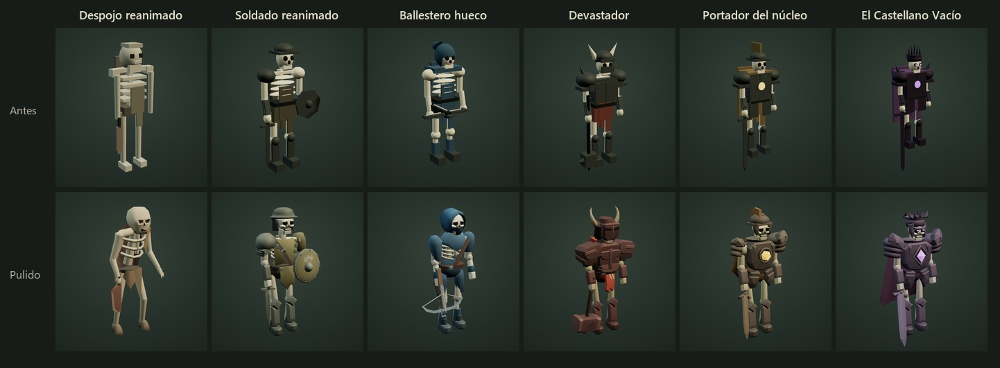
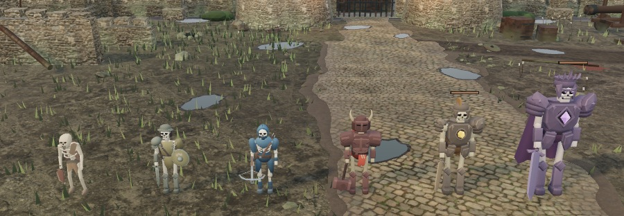

# Pulido de modelos de enemigos

20 de noviembre de 2026. Cinco rondas de trabajo por cada uno de los seis modelos. Las dos expediciones y el Atelier usan la misma geometría procedural original del proyecto. El detalle de color va por vértice y las piezas se agrupan por articulación y material.

## Cinco rondas por modelo

| Modelo | 1. Silueta | 2. Volúmenes | 3. Vestuario o arma | 4. Detalle y material | 5. Ajuste visual |
| --- | --- | --- | --- | --- | --- |
| Despojo reanimado | Postura encorvada con paso asimétrico | Cráneo anguloso, costillas arqueadas y pies anatómicos | Sudario plegado y tiras de lino rasgado | Manos curvas, cuchillo oxidado y contraste del rostro | Cuencas rebajadas, tela separada del torso y filo suavizado |
| Soldado reanimado | Sombrero de hierro con ala enrollada | Rodela abombada y espada facetada | Jubón rasgado, correa cruzada y hombrera en capas | Insignia de guarnición, umbo, remaches y canal de la espada | Insignia ajustada a la curva, correa asentada sobre el pecho y faldón trasero recortado |
| Ballestero hueco | Capucha abierta y puntiaguda | Culata perfilada y verga curva en la mano derecha | Esclavina y funda de virotes inclinada | Estribo, cuerda, guía de acero y emplumado | Velo ajustado a la mandíbula, mangas asimétricas y apoyo de la mano izquierda al apuntar |
| Devastador | Casco con cuernos curvos y hombros anchos | Visera escalonada, peto y láminas de cintura | Mazo pesado con cabeza forjada, abrazaderas y pomo | Paño de asedio, remaches y marcas de uso | Hombreras anguladas, gola, postura inclinada durante la carga y base más ancha |
| Portador del núcleo | Manto corto asimétrico y hombros definidos | Peto en relieve, carrilleras y escarcelas segmentadas | Núcleo ámbar facetado y engastado, con insignia en el manto | Espada ancha de una mano con guarda bifurcada | Cimera inclinada, pliegues más profundos e insignia sobre la superficie |
| El Castellano Vacío | Manto largo y corona irregular | Hombros en tres capas, gola y engaste en forma de escudo | Núcleo violeta, ojos encendidos y heráldica dorsal | Mandoble biselado inclinado con pomo visible | Diente roto en la corona, láminas anguladas y pliegues más legibles |

## Comprobaciones

- Chrome de escritorio a 1440 × 900. Se revisaron los seis modelos en el Atelier desde tres cuartos, perfil y espalda. En el escenario exterior se comprobó la lectura a 12 m, la marcha, el disparo del Ballestero, la carga del Devastador, el golpe del Soldado, el golpe de área del Portador y el golpe de área y la salva del Castellano. Estas poses se prepararon en una escena controlada con la cámara, el escenario y el renderizador del juego.
- Se arrancaron ambas expediciones desde el menú y se activaron sus primeros encuentros. La verificación del jefe se hizo en la escena controlada.
- La horda se revisó en el claro con 60 despojos. Los cuerpos aportaron una llamada de dibujo y 34.860 triángulos. Los avisos de ataque y aparición mantienen sus lotes instanciados. La prueba mide el coste geométrico local.
- 366 pruebas rápidas correctas y 45 pruebas dirigidas repetidas tras el ajuste final. `npm run lint` y `npm run build` pasaron, incluido el tipado. Continúan los avisos de Biome y de tamaño del paquete de Vite.

| Modelo | Mallas visibles antes → después | Triángulos antes → después |
| --- | ---: | ---: |
| Despojo reanimado | 1 → 1 | 524 → 581 |
| Soldado reanimado | 14 → 14 | 2.942 → 4.342 |
| Ballestero hueco | 13 → 16 | 2.554 → 3.888 |
| Devastador | 13 → 14 | 2.894 → 4.422 |
| Portador del núcleo | 14 → 14 | 3.150 → 3.808 |
| El Castellano Vacío | 14 → 14 | 3.532 → 3.860 |
